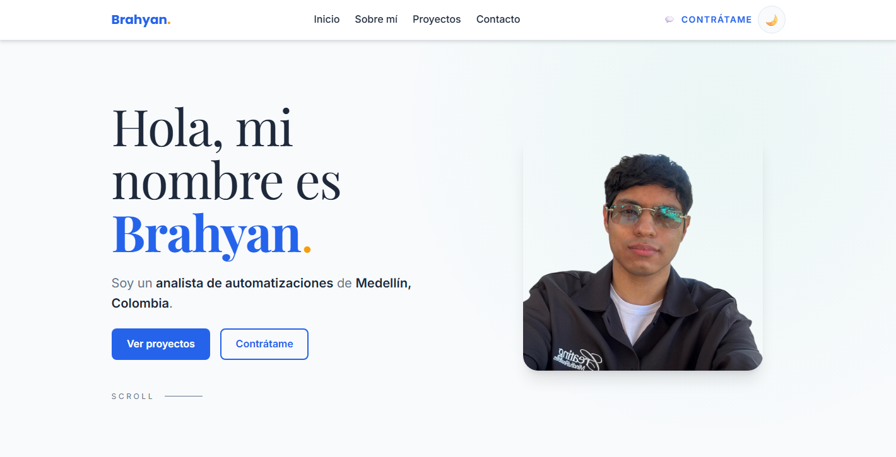
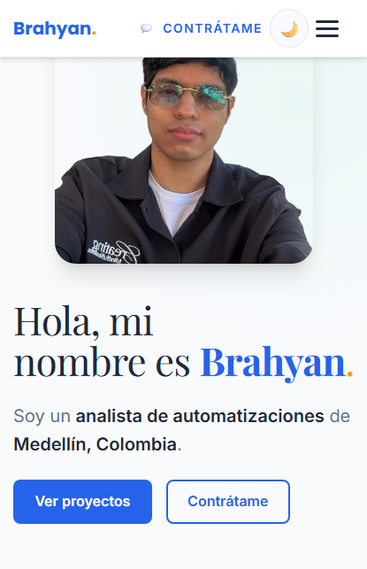
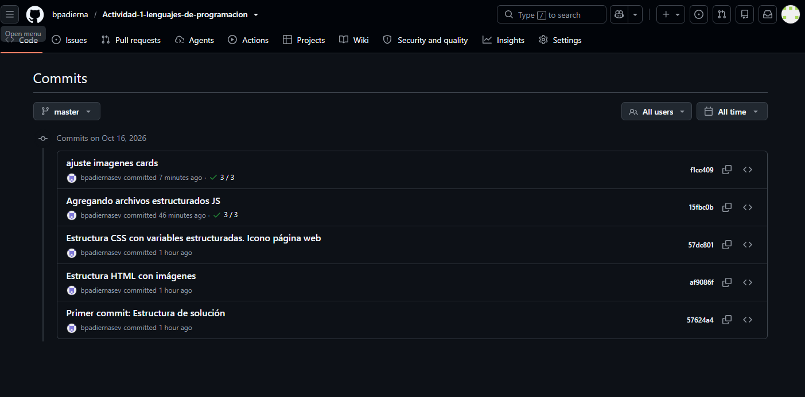

# Mi Portafolio Web Interactivo

Portafolio personal de **Brahyan** (analista de automatización), desarrollado como
actividad integradora de cierre de la Unidad 1 bajo la metodología **CDIO**
(Conceive – Design – Implement – Operate).

El sitio integra los tres pilares del desarrollo web frontend: **HTML5** estructural,
**CSS3** presentacional y **JavaScript** funcional.

## 📋 Descripción del proyecto

Sitio web estático de una sola página (one-page) que incluye:

- Sección de **presentación personal**.
- Sección **Sobre mí** con grid de habilidades.
- Lista de **proyectos** (mínimo 3) cargada dinámicamente desde un array de objetos en JavaScript.
- **Formulario de contacto** con validación en tiempo real (envío simulado con JS).
- **Diseño responsivo** mobile-first (móvil, tablet y escritorio).
- **Menú hamburguesa** en móvil y **cambio de tema claro/oscuro** persistente.

## 🛠️ Tecnologías utilizadas

| Pilar | Tecnología | Uso |
|-------|------------|-----|
| Estructura | HTML5 semántico | `header`, `nav`, `main`, `section`, `article`, `aside`, `footer` |
| Presentación | CSS3 | Variables CSS, Flexbox, CSS Grid, media queries, animaciones |
| Comportamiento | JavaScript (vanilla) | DOM, eventos, validación, Fetch-ready, localStorage |
| Versionado | Git / GitHub Pages | Control de versiones y despliegue |

## 📁 Estructura de archivos

```
Portafolio/
├── index.html
├── css/
│   ├── reset.css         # Normaliza estilos del navegador
│   ├── variables.css     # Guía de estilos (colores, tipos, espaciado) + tema oscuro
│   ├── layout.css        # Estructura y breakpoints responsivos
│   └── components.css    # Botones, tarjetas, inputs, animaciones
├── js/
│   ├── main.js           # Proyectos dinámicos, menú, tema, año
│   ├── form-handler.js   # Validación del formulario
│   └── animations.js     # Revelado al hacer scroll (IntersectionObserver)
├── assets/
│   ├── images/           # Brahyan.png, logos de herramientas y capturas
│   └── icons/
└── README.md
```

## 💻 Instrucciones de ejecución local

No requiere dependencias ni compilación. Opciones:

1. **Abrir directamente:** doble clic sobre `index.html`.
2. **Con un servidor local (recomendado):**
   ```bash
   # Con Python 3
   python -m http.server 5500
   # Luego abre http://localhost:5500
   ```
   O usa la extensión **Live Server** de VS Code.

## 🖼️ Capturas de pantalla

* 
* 
* 

## 👤 Autor y licencia

- **Autor:** Brahyan Padierna
- **Licencia:** MIT
